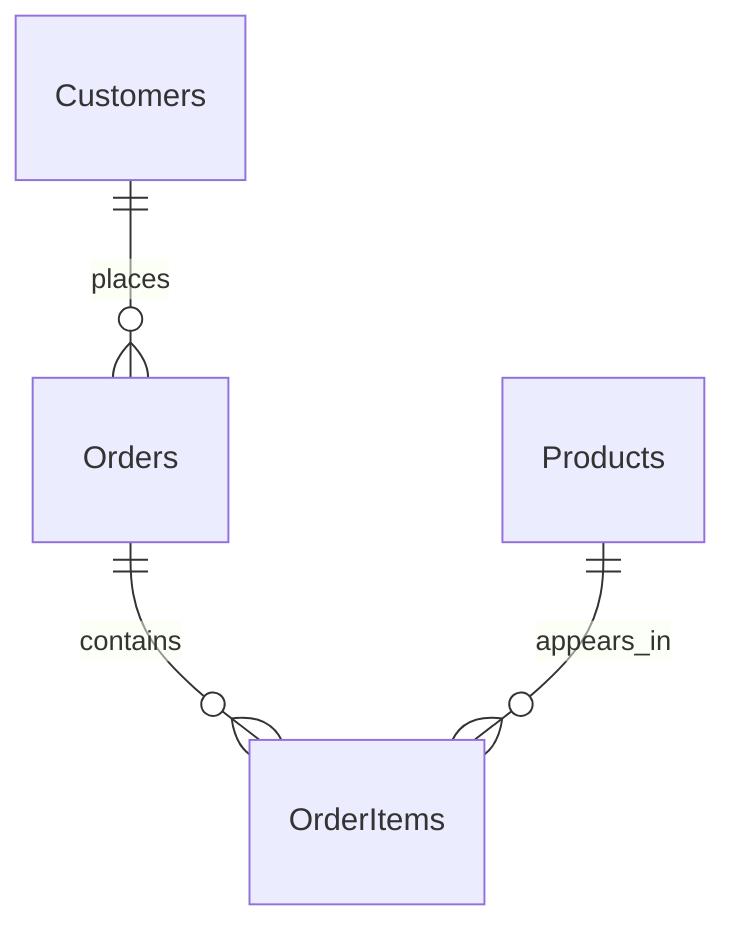

# Sales Analytics

A SQL Server 2025 portfolio project that translates synthetic sales transactions into monthly revenue trends, product rankings, customer insights, and average order value. It demonstrates relational modeling, readable T-SQL, exact decimal calculations, and repeatable data validation.

## Key results

For the supplied synthetic dataset, covering January-May 2026:

| Metric | Value |
| --- | ---: |
| Completed-order revenue | 14,950.00 RON |
| Completed orders | 8 |
| Average order value | 1,868.75 RON |
| Validation checks | 16 passed, 0 failed |

RON is the project's reporting currency convention. The schema stores numeric amounts without a currency column; queries return numeric values without currency labels or conversion.

## Business questions

- How does completed-order revenue change by month?
- Which products generate the most revenue, and how many units sell?
- Which customers contribute the most revenue and place repeat completed orders?
- What is the average value of a completed order?
- Do report totals reconcile, and does the dataset satisfy integrity checks?

## Technology stack

| Component | Technology |
| --- | --- |
| Database | Microsoft SQL Server 2025; database name: SalesAnalytics |
| Analysis | T-SQL, CTEs, LEFT/INNER JOINs, decimal aggregates, DENSE_RANK |
| Manual execution and verification | SQL Server Management Studio (SSMS) |
| Editing and documentation | VS Code, SQL files, Markdown |
| Portfolio version control | Git / GitHub-ready repository files |

## Database model

All four tables use the `dbo` schema. The seed contains 5 customers, 6 products, 10 orders, and 11 order items; all records are synthetic, and customer emails use example.com.



Each order references one customer. Each order item references one order and one product, linking orders and products at line level. Orders may exist without items. Identity primary keys, unique customer emails, foreign keys, and quantity/price CHECK constraints enforce the documented rules.

See the [data dictionary](documentation/data_dictionary.md) for all columns, defaults, constraints, and modeling limitations.

## Analytical reports

All reports include only orders with `Status = N'Completed'` and calculate revenue from the stored order-line price: `Quantity * UnitPrice`.

| Report | Business value | SQL | Documentation |
| --- | --- | --- | --- |
| Monthly sales revenue | Track revenue across calendar months; identify stronger and weaker periods | [01](database/queries/01_monthly_sales_revenue.sql) | [Guide](documentation/01_monthly_sales_revenue.md) |
| Top-selling products | Compare product revenue and units sold; prioritize assortment reviews | [02](database/queries/02_top_selling_products.sql) | [Guide](documentation/02_top_selling_products.md) |
| Customer sales analysis | Compare customer spending, frequency, and order value while retaining every customer | [03](database/queries/03_customer_sales_analysis.sql) | [Guide](documentation/03_customer_sales_analysis.md) |
| Average order value | Measure revenue per completed order without counting multi-item orders twice | [04](database/queries/04_average_order_value.sql) | [Guide](documentation/04_average_order_value.md) |

Product and customer rankings use DENSE_RANK by revenue/spending. Customer analysis and AOV count itemless Completed orders as zero-value orders. Monthly and product reports omit unmatched items; these zero-value orders do not affect revenue reconciliation.

## Project structure

```text
Sales_Analytics/
|-- README.md
|-- .gitignore
|-- database/
|   |-- schema/
|   |   |-- 01_create_tables.sql
|   |   `-- 02_seed_data.sql
|   |-- queries/
|   |   |-- 01_monthly_sales_revenue.sql
|   |   |-- 02_top_selling_products.sql
|   |   |-- 03_customer_sales_analysis.sql
|   |   `-- 04_average_order_value.sql
|   `-- tests/
|       `-- 01_validate_sales_data.sql
|-- documentation/
|   |-- data_dictionary.md
|   |-- 01_monthly_sales_revenue.md
|   |-- 02_top_selling_products.md
|   |-- 03_customer_sales_analysis.md
|   |-- 04_average_order_value.md
|   `-- 05_data_validation.md
`-- reports/
    `-- exports/
        `-- .gitkeep
```

`reports/exports/` is reserved for local outputs. Its contents are ignored except for .gitkeep, which preserves the empty directory in Git.

## Setup and execution order

Prerequisites: a SQL Server 2025 instance, SSMS, permission to create a dedicated demonstration database/tables and insert seed data, and SELECT access for reports and validation.

1. Obtain a local copy of the repository. In SSMS, create a fresh, empty database named `SalesAnalytics` and select it as the active database. No database creation script is included.
2. Run [01_create_tables.sql](database/schema/01_create_tables.sql) once to create the four tables in dependency order. It does not create the database.
3. Run [02_seed_data.sql](database/schema/02_seed_data.sql) once. Its transaction requires all four tables to be empty and inserts only the supplied synthetic records.
4. Run [01_validate_sales_data.sql](database/tests/01_validate_sales_data.sql). Expect 16 PASS checks and a PASS summary.
5. Run analytical queries 01 through 04 in numerical order, selecting SalesAnalytics as the active database and executing each complete statement, including its CTEs. The reports are independent and read-only.

**For an already prepared SalesAnalytics database, skip steps 1-3. Do not rerun the creation or seed scripts against populated tables.** Queries and validation can be rerun without modifying data. Do not use the setup scripts against production data.

## Validation

The project owner's manually verified SSMS results for the supplied synthetic dataset recorded **16 checks passed and 0 failed**. The SSMS AOV output also confirms 8 completed orders, 14,950.00 RON revenue, and 1,868.75 RON AOV. This records manual verification; the portfolio documentation update did not connect to SQL Server or rerun SQL.

The [validation script](database/tests/01_validate_sales_data.sql) checks table counts, completed-order count, revenue, AOV, reconciliation by month/product/customer, orphaned records, and invalid quantities/prices. It returns TestName, ExpectedResult, ActualResult, and Status, followed by a passed/failed summary. Fixed counts and monetary expectations apply only to the unchanged seed dataset.

See [validation documentation](documentation/05_data_validation.md) for all 16 checks, expected output, execution instructions, and limitations. Reconciliation validates aggregate consistency; it does not prove every record matches the seed or exercise every edge case.

## Assumptions and scope

Revenue uses order-line UnitPrice rather than current catalog Price. Pending and Cancelled orders are excluded. AOV equals completed revenue divided by completed-order count, rounded to two decimals; no completed orders yields zero. Reports cover all available dates, with monthly periods based on OrderDate.

The schema does not model currency conversion, taxes, discounts, refunds, costs, or payments. Results represent the defined sales measure rather than profit or cash receipts. The small synthetic dataset demonstrates SQL techniques and does not support conclusions about a real business.

## Repository hygiene

The .gitignore excludes local connection settings, credentials, SQL Server database/backup files, editor state, temporary files, and local exports. Only synthetic data belongs in this public portfolio. Review files before committing; ignore rules do not remove files already tracked by Git.
